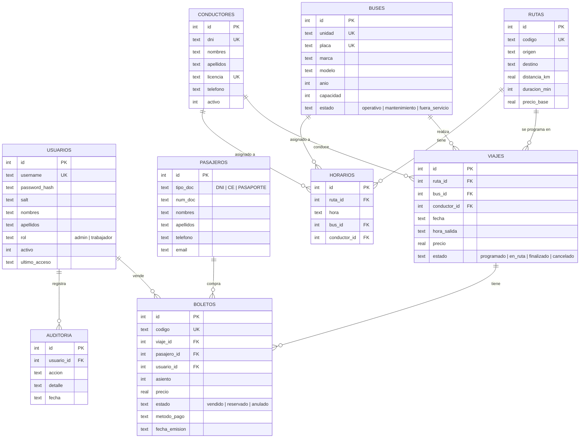

# Diagrama de la base de datos

Motor: **SQLite** · Archivo: `data/bus_system.db` · Esquema: `schema.sql`

> El bloque de arriba se ve como diagrama en GitHub, en VS Code (con la extensión *Markdown Preview Mermaid*) o pegándolo en https://mermaid.live

## Cómo se relaciona todo

- Un **viaje** es una salida concreta: *ruta + bus + conductor + fecha + hora*.
- Un **boleto** une un **viaje**, un **pasajero** y el **usuario** que lo vendió, en un **asiento**.
- Los **horarios** son la plantilla diaria de cada ruta; con ellos se generan los viajes de los próximos 7 días.
- La **auditoría** guarda quién inició sesión, vendió, anuló o modificó datos.

## Reglas que protege la base de datos

| Regla | Cómo |
|-------|------|
| No vender dos veces el mismo asiento | Índice único `ux_boletos_asiento_activo (viaje_id, asiento)` para boletos no anulados |
| El asiento debe existir en el bus | Trigger `trg_boletos_validar` |
| No vender en viajes que ya salieron o se cancelaron | Trigger `trg_boletos_validar` |
| No reducir la capacidad de un bus por debajo de asientos vendidos | Trigger `trg_buses_capacidad` |
| No borrar buses, rutas, conductores o pasajeros con historial | `FOREIGN KEY ... ON DELETE RESTRICT` |
| Un bus no puede tener dos viajes a la misma hora | `UNIQUE (bus_id, fecha, hora_salida)` |
| Placas, DNI, licencias y usuarios únicos | Restricciones `UNIQUE` |
| Valores válidos (rol, estado, método de pago, capacidad…) | Restricciones `CHECK` |

## Vistas

- `v_viajes`: cada viaje con su ruta, bus, conductor, vendidos, reservados y **asientos libres**.
- `v_boletos`: cada boleto con pasajero, ruta, bus y vendedor (para tickets e informes).
